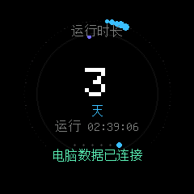
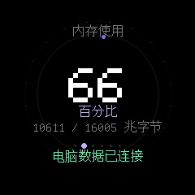
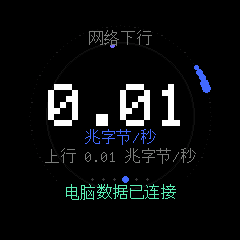
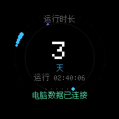

# ESP32-D0WD 圆屏电脑状态仪表盘

这是为 **ESP32-D0WD（经典 ESP32，不是 ESP32-S3）+ GC9A01 240×240 圆形 SPI 屏**制作的 CLion / PlatformIO 工程。固件在屏幕上显示 Windows 电脑的 CPU、内存、温度、网络、系统盘和运行时间，并通过同一局域网的 UDP 实时接收电脑端数据。电脑端不需要一直连 USB；USB 仅用于烧录、串口诊断，开发板仍需独立供电。

工程包含固件、Windows 数据采集脚本、CLion CMake 项目、页面截图和详细中文教程。推荐先阅读[完整使用教程](docs/使用教程.md)。

## 快速开始

1. 安装 Windows 10/11、CLion、Python 3.10+。在 CLion 插件中安装 PlatformIO，首次运行一次 PlatformIO 以安装 ESP32 平台工具链。
2. 在 CLion 选择 **File → Open**，打开本仓库根目录，选择 CMake preset `ESP32D0WD`。
3. 等待 PlatformIO 自动下载 ESP32 Arduino framework 及依赖，然后运行 `build.cmd`（或 CLion 的 `firmware` CMake target）。
4. 打开开发板电源并连接 USB，查看设备管理器的串口号，然后运行 `flash.cmd COMx`，例如 `flash.cmd COM7`。
5. 手机或电脑连接仪表配网热点 `D0WD-Dashboard-Setup`，打开 `http://192.168.4.1`，输入你的 2.4 GHz 路由器 Wi-Fi。固件将 SSID/密码保存在 ESP32 NVS，重启和掉电后仍会自动连接。
6. 电脑加入同一个局域网，安装 Python 依赖并启动 `run_pc_monitor.cmd`。屏幕收到电脑数据后即显示实时状态。

逐步截图、配网状态解释、问题排查和电脑监控端详细说明见[使用教程](docs/使用教程.md)。

## 屏幕页面

SW1 / SW2 用户按键切换页面，也会每 12 秒自动轮播：CPU 负载、内存、CPU 温度、网络下行、系统盘、电脑运行时间。页面使用黑色底色、大字号中文读数、圆环动态装饰和约 480 ms 的时间驱动过渡；每帧先清理画面，避免上页残留。布局截图使用模拟数据，仅用于检查位置和裁切：

| CPU | 内存 | 温度 |
|---|---|---|
|  |  |  |
| 网络 | 系统盘 | 运行时间 |
|  |  |  |

## 硬件与网络概要

| 信号 | GPIO |
|---|---:|
| 屏幕 SCK / MOSI | 14 / 15 |
| 屏幕 CS / DC / RESET | 5 / 27 / 33 |
| 屏幕背光 | 32 |
| SW1 / SW2 | 4 / 18 |

屏幕使用 Arduino_GFX GC9A01 驱动和 U8g2 UTF-8 字形。固件开启板载 PSRAM，优先使用 240×240 帧缓冲；内存不足时安全退回直接绘制。电脑脚本读取 Windows 系统时间、物理内存和系统盘，网络速率按活动物理网络适配器计数器的时间差计算。CPU 温度只读取 LibreHardwareMonitor / OpenHardwareMonitor 的可信 CPU 核心或封装传感器；没有传感器时明确显示不可用，不伪造数值。

电脑通过 UDP 4210 广播发送数据，因此通常不需要固定 IP。也可以在本机创建 `dashboard_ip.txt` 指定仪表地址；该文件已加入忽略列表，防止把家中局域网地址提交到 Git。详细字段、网络隔离和 Windows 防火墙排查见教程。

## 截图与诊断

- `tools/capture_all_pages.py COMx`：通过串口显示每页模拟数据并生成六张布局图；不会改动真实采集器。
- `capture_tft.cmd COMx`：保存固件所发送画面的镜像。屏幕本身没有像素回传线，所以这是绘制缓冲区镜像，不是 LCD 玻璃电气读回。
- 串口命令 `INFO`：查看 PSRAM、UDP 收包计数和绘帧耗时；`SCAN` 查看附近 Wi-Fi；`SETWIFI,SSID,PASSWORD` 写入并连接 Wi-Fi。

## 项目结构

```text
src/main.cpp                 ESP32 固件、圆屏 UI、配网、UDP 接收
tools/pc_monitor.py           Windows 状态采集与 UDP 发送
tools/capture_*.py            串口截图与页面布局工具
docs/使用教程.md              中文开发、烧录、配网和数据监控指南
docs/images/                  六页模拟数据布局截图
CMakeLists.txt                CLion 项目和 PlatformIO 构建 target
CMakePresets.json             ESP32D0WD CMake preset
platformio.ini                芯片、框架、引脚构建参数及依赖
```

## 版权与第三方组件

本项目原创代码、文档与设计按 [PolyForm Noncommercial 1.0.0](LICENSE) 许可：允许个人学习、实验、修改和非商业分享；商业用途必须事先取得 WU-AetherCore 的书面许可。版权仍归 WU-AetherCore。非商业限制意味着它是公开源码，但不属于 OSI 定义的开源许可项目。

Arduino_GFX 与 U8g2 及其字体资源按各自上游许可证提供，不能因本项目保留权利声明而改变其授权。第三方组件和许可说明见 [`THIRD_PARTY_NOTICES.md`](THIRD_PARTY_NOTICES.md)。

## 参考项目

- [Arduino_GFX](https://github.com/moononournation/Arduino_GFX)：GC9A01 彩屏驱动。
- [U8g2](https://github.com/olikraus/u8g2)：字形相关实现及字体来源。
- [kk_ui](https://gitee.com/keysking/kk_ui)：分页和缓动交互思路参考；本项目针对 240×240 彩色圆屏独立实现。
